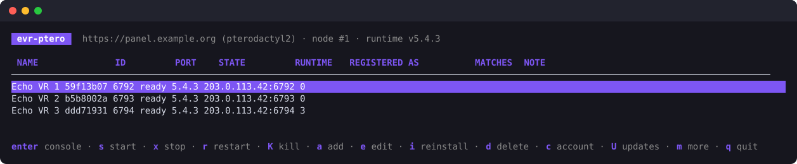
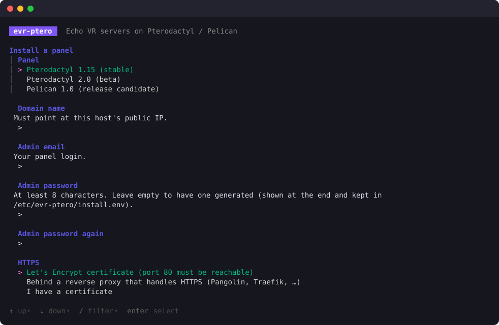
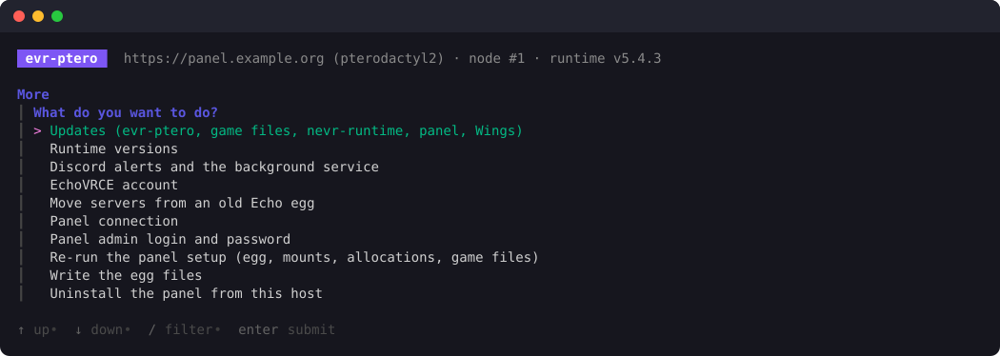
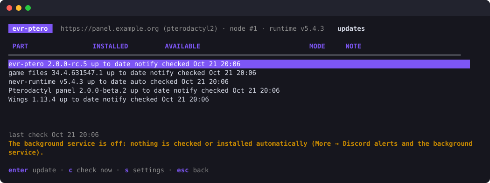

# Echo VR Server on Pterodactyl and Pelican

Run Echo VR dedicated servers with [nevr-runtime](https://github.com/EchoTools/nevr-runtime) on
[Pterodactyl](https://pterodactyl.io) or [Pelican](https://pelican.dev). `evr-ptero` sets everything up: it can install
the panel and Wings for you, or prepare a panel you already run, or just give you the egg. After that it manages the
servers from a dashboard in the terminal or with plain commands. You can also manage the servers in the panel.



> No panel wanted? See [Echo-VR-Server-on-Docker](https://github.com/marshmallow-mia/Echo-VR-Server-on-Docker).
> It uses the same image and runtime handling.

## Quick start

On a Debian 12 or 13 host (a VM, or a Proxmox LXC with `nesting=1,keyctl=1`):

```sh
curl -fsSL https://raw.githubusercontent.com/marshmallow-mia/pterodactyl_Echo_Server/main/install.sh | sudo sh
```

The installer downloads a checksum-verified `evr-ptero` binary of the newest release to `/usr/local/bin` (a
pre-release while there is no stable one; `EVR_VERSION=v2.0.0` picks one) and opens the setup wizard. Choose one of:

- **Install a panel with Wings on this host.** Pick Pterodactyl 1.15 (stable), Pterodactyl 2.0 (beta) or Pelican 1.0
  (release candidate), then answer a few questions: the domain, your admin email and password (or leave it empty to have one generated),
  how HTTPS is handled, and the ports.
  For HTTPS you can choose:
  - a Let's Encrypt certificate (port 80 must reach this host);
  - a reverse proxy that already handles HTTPS, such as Pangolin or Traefik;
  - a certificate you already have;
  - none, for testing.
- **Use an existing panel.** On the panel host itself, the API keys are created for you. For a panel elsewhere, paste
  an application API key, plus an admin account key so `evr-ptero` can start servers and show their console.
- **Only write the egg files** to import by hand (see [Doing it yourself](#doing-it-yourself)).



Then you choose how the servers sign in to EchoVRCE: a device link at echovrce.com/device (no password; you approve a
code and the Discord ID is filled in from your account), or your Discord ID and server password. If the link does not
complete, press `l` to try again, or later `c` → `l` in the dashboard.

`evr-ptero` then installs everything the panel needs for Echo VR:

- the game files and nevr-runtime, once per node;
- the egg;
- two read-only mounts;
- the game port allocations.

At the end the dashboard opens: press `a` to add servers. Run `sudo evr-ptero` again at any time to open it.

### Behind a reverse proxy (Pangolin, Traefik, …)

Choose "Behind a reverse proxy" in the wizard. You need two proxy resources, both forwarding plain http to this host:

| Hostname | Target | Proxy login |
|---|---|---|
| panel domain, e.g. `panel.example.org` | `http://<host>:80` | allowed |
| Wings domain, e.g. `wings.example.org` | `http://<host>:443` | **off**: the browser opens the console and file manager directly |

### Behind NAT

Enter the internal ports in the wizard. The game ports (UDP, from 6792) must be forwarded 1:1, with the same number
outside and inside. The backend registers a server at the address it connects from and the port the game bound, so a
forward to a different port number points players at the wrong place.

## How it works

```
/srv/echovr/                    on the node, shared by all servers
  game/34.4.631547.1/           the game, verified
  game/current → …
  nevr/v5.4.2/                  nevr-runtime (BugSplat64.dll), checksum-verified
  nevr/current → v5.4.2         switched by updates; servers follow at their next match
/etc/evr-ptero/config.yaml      panel connection and server defaults
/etc/evr-ptero/secrets.env      API keys and the account (mode 0600)
```

- **The egg** runs the image `ghcr.io/marshmallow-mia/echovr-pterodactyl`. The image is
  [the Docker product's](https://github.com/marshmallow-mia/Echo-VR-Server-on-Docker) Wine image plus the Wings entrypoint.
  The egg's variables are the server's settings: Discord ID, password, regions, guilds, tick rate and runtime version.
- **Two read-only mounts** give every server the same game copy (`/opt/echovr/game`) and runtimes (`/opt/echovr/nevr`),
  so a new server needs no 5 GB download. `evr-ptero` also adds the paths to Wings' `allowed_mounts`. Servers that
  cannot use mounts can set `GAME_SOURCE=download` and get their own copy.
- **`evr-supervisor`** runs inside each server and handles the runtime's quirks:
  - It writes the runtime config and the port. nevr-runtime 5.4.2 ignores `-port`, so the port goes into a per-server
    `netconfig_dedicatedserver.json`.
  - It restarts the game after every match, because the runtime exits when a match ends.
  - It detects rejected logins, unreachable ports and stuck registrations.
  - It handles the runtime's shutdown hang, so a stop in the panel takes a few seconds.
  - It prints `[evr] READY` once the server is registered, which the panel shows as Running.

## Dashboard

`sudo evr-ptero` shows every Echo VR server of the panel with its state, the address it registered as, its runtime
version, and how many matches and restarts it has had.

| Key | Action |
|---|---|
| `enter` | live console from the panel (`f` follow, `a` show runtime noise, `/` filter) |
| `s` / `x` / `r` / `K` | start / stop / restart / kill |
| `a` / `e` / `d` | add servers / edit one (regions, guilds, tick rate, empty TTL, runtime pin) / delete |
| `i` | reinstall a server (runs the egg's install step again) |
| `U` | updates of evr-ptero, the game files, nevr-runtime, the panel and Wings: install, pick a version, settings |
| `M` | move servers from an old Echo egg (only when the dashboard reports some) |
| `c` | account: sign-in state and registered servers; `l` links this host at echovrce.com/device, `p` signs in with a password, `o` takes the account from an old installation's game folder |
| `m` | more: updates, runtime versions, Discord alerts and the background service, moving servers from an old Echo egg, the panel connection, the panel admin login (show it, set or generate a new password), re-running the setup, the egg files, uninstalling the panel |

A running device link can be cancelled with `esc`, and a failed one retried with `l`.



## Commands

Everything in the dashboard is also a command, and every command is also in the dashboard. Add `--json` for scripts and
`-y` to skip confirmations.

```
evr-ptero init                          guided setup; with flags unattended (init --help)
evr-ptero panel install|setup|info      install a panel here / prepare a panel / show the connection
evr-ptero panel login [--show-password]  the admin login the installer created
evr-ptero panel password [--user EMAIL] [--generate | --password-stdin]   change a panel user's password
evr-ptero panel uninstall [--purge-packages --purge-docker]
evr-ptero server ls
evr-ptero server create -n 2 [--regions euw] [--guilds ID,…]
evr-ptero server edit NAME --tick-rate 90 --regions euw,default
evr-ptero server start|stop|restart|kill NAME…
evr-ptero server logs NAME               follow the console
evr-ptero server reinstall|rm NAME
evr-ptero account link|set|test|servers  device link (no password) or password sign-in; updates every server
evr-ptero runtime ls|use TAG|rollback|remove TAG
evr-ptero update [check|ls|apply|settings]   evr-ptero itself, game files, nevr-runtime, panel, Wings
evr-ptero agent install|uninstall|run|webhook URL  metrics, Discord alerts, automatic runtime updates
evr-ptero files install                  game and runtime into a directory
evr-ptero egg export --format ptdl|plcn  the egg for importing by hand
evr-ptero migrate detect|run             move servers from the old Echo egg
```

Unattended install, for example Pelican behind a reverse proxy:

```sh
sudo evr-ptero init --mode install --product pelican --fqdn panel.example.org --wings-fqdn wings.example.org \
    --tls proxy --email you@example.org --ports 10
```

Without `--password-stdin` the setup ends with the device link and prints the code to approve, like the wizard
(`--no-link` skips it).

## Updates



`U` in the dashboard lists every part with the installed and the available version. `enter` updates one (you can pick
the version), `c` checks again, `s` sets how each part is updated:

| Part | What an update does | Default |
|---|---|---|
| `evr-ptero` | downloads the new release, checks it against `checksums.txt`, replaces the binary (the old one stays as `evr-ptero.prev`) and restarts; the egg and the servers move to the image released with it, each server at its next restart | notify |
| game files | fetches missing or changed files of the node's shared copy from the mirror and verifies the build; servers use them from their next restart. Echo VR no longer changes, so this is a repair | notify |
| nevr-runtime | installs the version of the runtime channel and tries it on one idle server first; only if that server registers do the others switch, at their next match boundary. A version that fails is skipped | auto |
| panel | backs up the panel files and database to `/var/backups/evr-ptero` (the last 3 are kept), maintenance mode, the new release, `composer install`, migrations, queue restart. If the panel API does not answer afterwards, the backup is restored | notify |
| Wings | replaces the binary and restarts Wings; game servers keep running. If Wings does not come back, the old binary is put back | notify |

The panel and Wings appear when they run on this host. Each part is `off`, `notify` (checked; shown in the dashboard
and sent as a Discord alert) or `auto` (installed by the background service), optionally only inside a time window such
as `04:00-06:00`. The panel follows its installed channel (Pterodactyl 1.x stable, or 2.x beta); you can pick any newer
release by hand, and moving to another channel, e.g. 1.x to 2.x, asks you to type the version first, because that
migration only goes forward. The same with commands:

```
evr-ptero update                                   check everything
evr-ptero update ls self|game|runtime|panel|wings  versions to choose from
evr-ptero update apply panel [--version V] [--dry-run]
evr-ptero update settings --panel notify --wings auto --window 04:00-06:00 [--panel-channel beta]
```

Mods will be one more part here.

## Alerts and metrics

A small background service on the node (dashboard: `m` → Discord alerts and the background service, or
`sudo evr-ptero agent install`) runs the update checks above, and:

- **Discord alerts.** Enter a webhook URL in the same dashboard form (or `evr-ptero agent webhook https://discord.com/api/webhooks/…`)
  and a test message is sent. You then get
  alerts when a server stops on an error, keeps restarting, stays down or recovers, and when an update is available,
  installed or fails.
- **Prometheus metrics** on `127.0.0.1:9470/metrics`.

## Doing it yourself

`evr-ptero` is not needed at run time; the egg and the image work on their own.

1. Import the egg from the [release](https://github.com/marshmallow-mia/pterodactyl_Echo_Server/releases) matching your
   panel: `egg-echovr-nevr.json` for Pterodactyl (Admin → Nests → Import Egg) or `egg-echovr-nevr.yaml` for Pelican
   (Eggs → Import).
2. Either create servers with `GAME_SOURCE=download`, which gives each server its own copy of the game, or share one
   copy:
   - Put the game in `/srv/echovr/game/current` and nevr-runtime in `/srv/echovr/nevr/current/BugSplat64.dll`
     (`evr-ptero files install --dir /srv/echovr` does both).
   - Add the paths to `allowed_mounts` in the Wings config.
   - Create two read-only mounts, `/srv/echovr/game` → `/opt/echovr/game` and `/srv/echovr/nevr` → `/opt/echovr/nevr`,
     for the egg and the node.
3. Give each server one allocation in the game port range and fill in the egg variables.

## Moving from v1

The old guide and egg are kept on the [`v1`](https://github.com/marshmallow-mia/pterodactyl_Echo_Server/tree/v1) branch.
Nothing has to be reinstalled: the panel, Wings and the servers stay, only the servers' egg changes.

On the panel host, run `sudo evr-ptero` and pick "Use an existing panel". When the dashboard finds servers on an old
Echo egg, it says so; press `M` (or `m` → Move servers from an old Echo egg) and pick the servers. If evr-ptero has no
account yet, the same form signs in first, by default with the account the old servers used (read from
`/opt/ready-at-dawn-echo-arena/_local/config.json`, the other folders Wings may mount, or the servers' own folders).
The same with commands:

```sh
sudo evr-ptero init                 # connect to the panel
sudo evr-ptero migrate detect       # lists the old servers and the account found for them
sudo evr-ptero migrate run          # signs in with that account when none is set, then moves the servers
```

`migrate run` switches each old server to the new egg and image, keeping its allocation, owner and limits. It gives the
server the account and the shared game files, and restarts it. The old egg, the old game folder and any game files in
the servers' own folders are left alone; delete them once everything works. To take the account from an old game folder
on its own: account screen → `o`, or `evr-ptero account set --from-game-dir /opt/ready-at-dawn-echo-arena`.

## Troubleshooting

- A server that stays at "starting" in the dashboard shows the reason in its console. Common ones:
  - `bad_credentials`: the backend rejected the Discord ID or password.
  - `udp_unreachable`: the backend could not reach the game port; check the 1:1 port forward.
  - `registration_rejected`: the server did not register in time.
- Under Proxmox LXC, Docker needs `nesting=1,keyctl=1`.
- Can't log in to the panel? `m` → Panel admin login and password (or `sudo evr-ptero panel login --show-password`)
  shows the admin login; set a new password there or with `evr-ptero panel password`. "Forgot password" in the panel
  needs mail, which the installer does not set up.
- The panel installer resumes where it stopped: run the same command (or the wizard) again after fixing the cause.

## Building

```sh
go test ./...
go build ./cmd/evr-ptero
docker build -f image/Dockerfile -t echovr-pterodactyl:dev .
```

The shared packages (game files, runtime releases, `config.yaml`, the EchoVRCE account API, the supervisor, status,
metrics, alerts, updates) come from the Docker repo's `pkg/`.

## License

GNU General Public License v3.0. Echo VR is property of Meta / Ready At Dawn and is not included; nevr-runtime is
Apache-2.0 by EchoTools.
